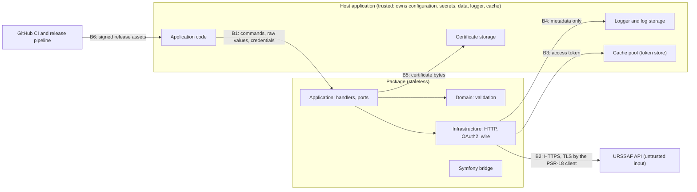

# Security assurance case

This document argues why the security requirements of `thebeardedbear/urssaf-mobilite-internationale` are, or will be,
met. The package is a library, so part of the security of a deployment belongs to the host application (see
[Assumptions on the host](#7-assumptions-on-the-host-application)).

**Status.** The six operations, the HTTP gateway, the framework-free builder and the Symfony bundle are implemented
([docs/roadmap.md](../roadmap.md)); the package is not released yet. The claims below were re-checked against the code
(`src/`) at the implementation review of November 2026 and describe what the code does, not what it should do. Two
limits remain: the wire mapping is not yet confirmed against the real URSSAF sandbox (no official payload example
exists), and the sections on the pipeline (SR8, B6) describe the repository settings, which are verified in the GitHub
project and not in this repository.

Reporting a vulnerability: [SECURITY.md](../../SECURITY.md).

## 1. What is protected

The package lets an application ask URSSAF to enrol a company, list, read and delete its enrolments, submit a posting
request (*détachement*) of a worker within the EEA, and download the resulting mobility certificate (PDF). It
authenticates with OAuth2 client credentials. It is stateless: it keeps no data between calls
([ADR 0001](../adr/0001-stateless-sdk.md)).

| Asset | Where it lives | Sensitivity |
|---|---|---|
| OAuth2 `client_id` / `client_secret` | Host configuration or `CredentialsProvider`; in memory only | Secret |
| Access token | `TokenStore` (PSR-6 / PSR-16 cache pool), in memory during a call | Secret, short lived |
| Posting request payload: worker NIR and `cleNir`, surname, first names, birth date and place, postal and host addresses, e-mail, phone numbers, signatory | Built by the host, sent once, never kept by the package | Personal data (GDPR), including the social security number |
| Company identifiers (SIREN, NIC, activity company, referenced companies) | Request and response bodies | Business identifiers |
| Mobility certificate | Binary PDF (`application/pdf`) returned by URSSAF, handed to the host | Personal data and legal document, integrity critical |
| Enrolment data and declaration ids | Responses, handed to the host | Technical identifiers |
| Source code and releases | GitHub repository, Packagist, release assets | Integrity critical (supply chain) |

## 2. Security requirements

| ID | Requirement |
|---|---|
| SR1 | Credentials and tokens are never persisted by the package, never logged, never present in exception messages, and masked when dumped. |
| SR2 | Personal data (NIR, names, addresses, birth data, contact details) is never persisted by the package, never logged, never present in exception messages nor in integration events or error codes ([ADR 0006](../adr/0006-personal-data.md)). |
| SR3 | A posting request is never resent automatically after an answer lost on the network: the outcome is reported as unknown to the host, which reconciles it ([ADR 0004](../adr/0004-unknown-outcome-and-retry.md)). |
| SR4 | Everything received from URSSAF is untrusted: parsed strictly, never executed or deserialised into arbitrary objects, a malformed response fails closed, and values taken from a response and used in a later request are encoded. |
| SR5 | The PDF certificate is returned to the host as a stream, byte for byte, never buffered whole, interpreted, rendered or logged by the package ([ADR 0005](../adr/0005-files.md)); its size is bounded by the host's PSR-18 client settings. The only code that writes it to disk is the `urssaf:mi:certificate` console command of the Symfony bridge, at the path the operator gives, with mode `0600`. |
| SR6 | Requests are authenticated and sent to the intended URSSAF host over HTTPS; one tenant can neither use nor see another tenant's credentials or tokens ([ADR 0007](../adr/0007-tenant-model.md)). |
| SR7 | A failure of URSSAF or of the network degrades gracefully: typed failures with an explicit "may have reached URSSAF" signal (`UrssafUnavailable::mayHaveReachedUrssaf()`, `OutcomeUnknown`) and the `Retry-After` value, no unbounded loop. The package performs no retry: the only repeat is one replay after a 401 (which proves nothing was processed); the caller decides the rest ([ADR 0004](../adr/0004-unknown-outcome-and-retry.md)). |
| SR8 | The code and the release artefacts come from the maintainers' reviewed and tested commits and can be verified by consumers. |

## 3. Threat model

| Actor | Capability considered | Main threats |
|---|---|---|
| Network attacker | Observes or tampers with traffic between the host and URSSAF | Eavesdropping on tokens, NIR or the certificate, response tampering, downgrade |
| Malicious or compromised URSSAF endpoint (or a proxy configured as such) | Returns arbitrary bodies, statuses, headers, sizes, error texts, ids and a fake PDF | Injection through response fields reused in paths, deserialisation, resource exhaustion, personal data echoed in error text |
| Host application bug or misconfiguration | Controls configuration, logger, cache, listeners and what it does with the PDF | Secrets in clear configuration, `http://` base URI, shared cache, verbose logs, certificate left readable, NIR in logs |
| Other tenant of a multi-tenant host | Uses the same host application | Cross-tenant use of credentials or tokens |
| Hostile user-supplied data | Names, addresses, identifiers reach the package through the host | Header, path or JSON injection, malformed values reaching URSSAF |
| Malicious contributor, poisoned dependency, abused CI token | Pull request, dependency update, workflow permissions | Backdoor in the package, secret exfiltration from CI, tampered release |

Out of scope: compromise of the host server itself, what the host does with personal data after the call, and the
security of the URSSAF platform (see [SECURITY.md](../../SECURITY.md#scope)).

## 4. Trust boundaries

| Boundary | What crosses | Control in the package |
|---|---|---|
| B1 host to package | Commands, raw values (NIR, names, addresses, dates, country codes) | Value objects validate at construction (lengths, patterns and closed lists from the contract, [ADR 0008](../adr/0008-local-validation.md), [ADR 0011](../adr/0011-country-and-closed-lists.md)); credentials only through `CredentialsProvider` |
| B2 package to URSSAF | HTTPS requests with a bearer token and a JSON body; untrusted JSON, empty or PDF responses | TLS and certificate verification delegated to the PSR-18 client; an overridden base or token URI must be `https`, without user info, query or fragment (`HttpsUri`); the only path segments built from variable data are UUID value objects (`EnrolmentId`, `DossierId`, validated by pattern), query pairs and the token form body are encoded with `http_build_query` (RFC 3986); strict JSON decoding (`JSON_THROW_ON_ERROR`, default depth 512) and typed mapping; error bodies accepted as object, list or empty ([ADR 0002](../adr/0002-http-client-adaptations.md)) |
| B3 package to cache | Access token | Hashed cache key (`hashed_` + SHA-256), item expires with the token, a malformed item is a cache miss |
| B4 package to logs | Technical metadata | Fixed set of fields: method, path template, status, duration, request id when configured, exception class on a transport error; no body, no NIR, no name, no token |
| B5 package to host | The certificate as `CertificateResult` (available with the PDF bytes, in progress, refused or unknown) | Content streamed unchanged ([ADR 0003](../adr/0003-certificate-result.md), [ADR 0005](../adr/0005-files.md)); the library writes it nowhere, only the `urssaf:mi:certificate` command writes it, to the path it is given (mode `0600`, existing file kept unless `--force`, partial file removed on failure) |
| B6 pipeline to consumers | Releases | Pinned actions, least-privilege tokens, SLSA provenance, checksums |

Inside the package, Deptrac enforces the layers that separate these zones (`deptrac.yaml`).

## 5. Secure design principles

Saltzer and Schroeder principles mapped to the design and to the controls in place.

| Principle | How it is applied | Where |
|---|---|---|
| Economy of mechanism | No third-party runtime code: `require` lists only PSR interfaces and PHP extensions; the HTTP client, cache and logger come from the host. | `composer.json`, [ADR 0000](../adr/0000-reference-architecture.md) |
| Fail-safe defaults | The environment (sandbox or production) is explicit; the default logger is a `NullLogger`; a malformed cached token is a cache miss; unknown enum values from URSSAF are kept raw, never cast. | `Infrastructure\Urssaf\Http\JsonApiClient`, `Infrastructure\TokenStore\CachedAccessToken`, `Infrastructure\Urssaf\UrssafGatewayFactory` |
| Complete mediation | Every URSSAF call goes through one client (token, status interpretation); value objects have private constructors so every instance went through validation. | `JsonApiClient`, `src/Domain/**` |
| Open design | Open source, documented protocol mapping and decisions (ADRs), public quality thresholds. | `README.md`, `docs/`, `CONTRIBUTING.md` |
| Separation of privilege | Strict layers: Domain depends on nothing, Application on Domain, Infrastructure and bridges on the layers below. | `deptrac.yaml` (enforced by `make deptrac`) |
| Least privilege | Credentials fetched per tenant on demand; one OAuth2 scope; CI workflows default to `contents: read` and elevate per job. | `.github/workflows/*.yml` |
| Least common mechanism | Token cache key derived from environment, base URI, token URI, scope and client id, so two tenants with different credentials never share a token. | `Infrastructure\TokenStore\CacheKey`, [ADR 0007](../adr/0007-tenant-model.md) |
| Psychological acceptability | The secure path is the default path: secrets through `%env()%`, one bundle to wire the gateway. | `docs/` |
| Defence in depth | Secrets masked in `__debugInfo()`, marked `#[SensitiveParameter]`, not serialisable, not logged; the payload of a posting request is never in a log or an exception; objects holding personal data refuse serialisation (`PersonalDataNotSerializable`) and hide their value in `__debugInfo()`. | `Application\Port\Credentials`, `Domain\Posting\PersonalData`, [ADR 0006](../adr/0006-personal-data.md) |
| Fail securely | HTTP errors become typed exceptions carrying the status and the raw URSSAF errors (`ApiErrors`), never the payload; an unexpected status or body raises an explicit exception; no automatic resend of a posting request. | `JsonApiClient`, `ResponseInterpreter`, [ADR 0004](../adr/0004-unknown-outcome-and-retry.md) |

## 6. Common implementation weaknesses and how they are countered

| Weakness (OWASP Top 10 2021 / CWE) | Countermeasure | Where, verified by |
|---|---|---|
| HTTP, header and path injection (CWE-93, CWE-113, CWE-22) | Every variable path segment (enrolment id, dossier id, including values read from URSSAF answers) is a UUID value object validated by pattern before it reaches a path, so it cannot carry a separator or a control character; query pairs and the token form body go through `http_build_query` (RFC 3986); the JSON body is built with `json_encode`, never by concatenation; a request id header name is validated. | `UrssafHttpGateway`, `RequestBuilder`, `Wire\JsonEncoder`; unit tests |
| Sensitive data exposure (A02, CWE-200, CWE-532) | Logs hold method, path, status, duration, the request id when configured and the exception class only. Exception messages hold violation codes, statuses and field names, not the rejected value (NIR, names, addresses never appear). Debug output is masked. The `code`, `message` and `description` returned by URSSAF may echo submitted values: the console commands print them only with `--show-urssaf-errors`. | `JsonApiClient`, exception classes, console commands; unit tests |
| Cleartext transmission, improper certificate validation (CWE-319, CWE-295) | Default hosts are `https://`; an overridden base or token URI must be `https` even for a local host; the package never disables verification (the PSR-18 client owns TLS). | `Environment`, `HttpsUri`, [ADR 0002](../adr/0002-http-client-adaptations.md) |
| Insecure deserialisation (A08, CWE-502) | Responses are decoded with `json_decode` into arrays, never `unserialize`; the PDF body is passed through as an opaque stream. | `Wire\JsonDecoder`, `Psr7BinaryStream` |
| Improper input validation (CWE-20) | Length limits and anchored patterns (NIR `[0-9]{6}[0-9AaBb][0-9]{6}`, `cleNir` two digits, SIREN, NIC), closed lists, `""` rejected for countries; response fields read through typed accessors. | `src/Domain/**` |
| Malicious file content (CWE-434, CWE-79) | The certificate is streamed as bytes and never rendered or parsed; the library does not write it, and the console command writes it only to the path the operator gives, with mode `0600`; the host must treat it as untrusted input (assumption 4). | `DownloadedFile`, `CertificateFile` |
| Hard-coded credentials (CWE-798) | None in the repository; secrets come from the host; fixtures use fictitious values; GitHub secret scanning with push protection is enabled. | `CONTRIBUTING.md`, repository settings |
| Weak randomness (CWE-330, CWE-338) | `random_bytes()` for the optional request id; SHA-256 for cache keys; no `rand`, `mt_rand`, `uniqid`, MD5 or SHA-1. | `Infrastructure\Id\SecureRandomBytes`, `CacheKey` |
| Authentication failures (A07) | Client-credentials flow; the token is renewed shortly before expiry (safety margin, 60 s by default in the bundle); a 401 invalidates the cached token and triggers one replay; authentication errors on the token endpoint are not retried. | `OAuth2TokenProvider`, `JsonApiClient` |
| Broken access control, tenant isolation (A01, CWE-639) | Credentials and tokens resolved per tenant; the package stores no tenant data. | `CredentialsProvider`, [ADR 0007](../adr/0007-tenant-model.md) |
| Resource exhaustion (CWE-400, CWE-770) | No retry loop (one replay after a 401 at most), JSON depth limit (512, PHP default), certificate streamed instead of buffered; the HTTP timeout (15 s default of the bundle's client) and any response size limit belong to the PSR-18 client of the host, and the package enforces no maximum page size (the caller chooses `limit`). The opt-in rate limiter bounds the local call rate. | `JsonApiClient`, `Wire\JsonDecoder`, bundle `http_timeout` |
| Vulnerable and outdated components (A06) | No third-party runtime code. Development tooling: `composer audit` in CI and `make composer-checks`, Dependabot weekly (Composer and GitHub Actions), committed `composer.lock`. | `composer.json`, `.github/dependabot.yml`, `.github/workflows/ci.yml` |
| Supply chain, integrity failures (A08) | Actions pinned to a commit SHA; `contents: read` by default, elevated per job; no `pull_request_target`; CodeQL for workflows; OpenSSF Scorecard; releases carry `SHA256SUMS` and a SLSA provenance attestation; DCO sign-off on every commit; the `main` ruleset requires pull requests and status checks. | `.github/workflows/*.yml`, `SECURITY.md`, `bin/check-dco` |
| SSRF (A10, CWE-918) | The path is built from constants and encoded segments; only the base URI is variable and it is operator configuration, never derived from URSSAF responses or user input. | Configuration |
| Insecure design (A04) | The threat model above, layers enforced by tooling, an explicit unknown-outcome signal, no automatic resend of a posting request. | `deptrac.yaml`, [ADR 0004](../adr/0004-unknown-outcome-and-retry.md) |

### Tools that verify these countermeasures

| Tool | What it checks | Where it runs |
|---|---|---|
| PHPStan level max (strict, deprecation, Symfony, PHPUnit rules) | Type safety, unsafe patterns | CI `phpstan`, `make phpstan` |
| Mago lint and analyze (`--minimum-fail-level=note`) | Static analysis | CI `mago`, `make mago` |
| Deptrac | Layer boundaries inside the package | CI `deptrac`, `make deptrac` |
| PHPUnit with 100% line, method and class coverage, and at least 96% branch coverage | Behaviour including failure paths | CI `coverage` and `coverage-branches`, `bin/check-coverage`, `bin/check-branch-coverage` |
| Infection with 100% MSI and covered MSI | The tests detect behaviour changes | CI `infection`, `make infection` |
| SonarQube Cloud (when enabled by the repository variable) | Vulnerabilities, security hotspots | CI `sonarcloud` |
| `composer audit`, Dependabot | Known vulnerable dependencies | CI `composer-checks`, Dependabot |
| CodeQL on the GitHub Actions workflows | Workflow injection, excessive permissions | `.github/workflows/codeql.yml` |
| OpenSSF Scorecard | Supply-chain practices | `.github/workflows/scorecard.yml` |
| SPDX header guard, DCO check | Licence headers, sign-off of every commit | CI `guard`, `dco` |
| SLSA provenance attestation and `SHA256SUMS` | Provenance of release archives | `.github/workflows/release.yml` |
| GitHub secret scanning with push protection | Committed secrets | Repository setting |

## 7. Assumptions on the host application

The assurance above holds if the host application:

1. keeps `client_secret` in a secret store or environment variable (a literal in committed configuration ends up in
   the compiled container) and restricts who can read it;
2. provides a PSR-18 client that verifies TLS certificates, with safe redirect behaviour, a response size limit and
   timeouts, and does not override the base URI with a non-HTTPS URL outside tests;
3. uses a token cache pool private to the application: the access token is stored there in clear for its lifetime;
4. treats the certificate PDF as untrusted input and protects it (restrictive file permissions, encrypted storage,
   retention policy, deletion after use), since it holds personal data of the posted worker;
5. protects the NIR, names and addresses it collects (access control, encryption at rest, retention and erasure
   policy), and records the lawful basis of the processing: the package stores nothing;
6. does not log request or response bodies at its own HTTP-client level, and does not put personal data in the
   messages of exceptions raised by its own listeners.

## 8. Residual risks

- The package does not check the NIR key (`cleNir`) nor the existence of a company; URSSAF does.
- The size of a JSON response or of the PDF is not capped by the package; the host's HTTP client should.
- No official payload example exists yet ([API reference](../api-reference.md), section 5): the wire mapping is built
  from the contract and has not been confirmed against the real sandbox; this is done before the first release
  ([ROADMAP.md](../../ROADMAP.md)).
- The rules URSSAF does not publish (per-profile mandatory fields, `dateDebut` against `dateFin`, SIREN checksum) are
  not checked locally ([ADR 0008](../adr/0008-local-validation.md)); URSSAF is the judge.
- After an `OutcomeUnknown` on a posting, the package cannot tell whether the declaration was recorded and no API lists
  postings: the host must reconcile outside the API.

## 9. Keeping the case valid

The case is revisited when a change touches a trust boundary: a new outbound call, a new persisted field, a new
logging statement, a new way to read or write a file, a new dependency, a new workflow permission. Pull requests run
the full quality gate (`make ci`). The code review of the implementation against this case is recorded in the Status
paragraph; it is repeated, and the paragraph updated, when the first release is prepared.
